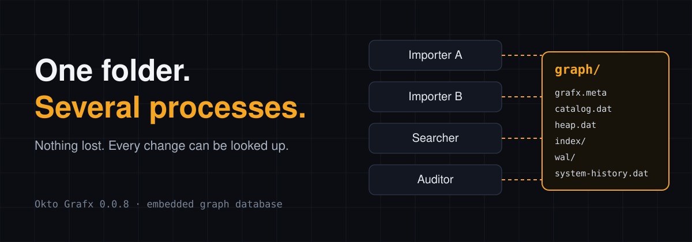
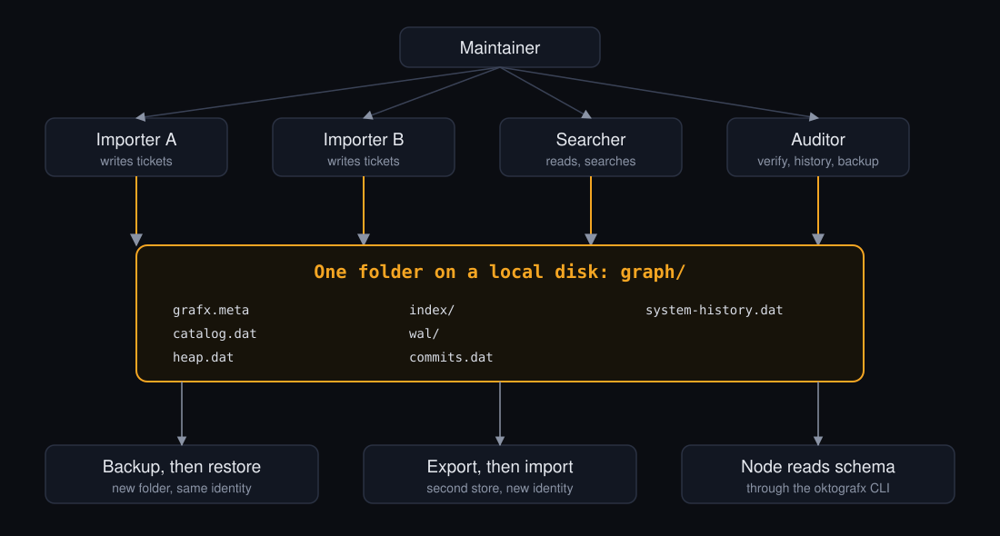

# grafx-shared-store-longrun-demo



One folder. Several processes. Nothing lost, and every change can be looked up.

A small support desk keeps its tickets, customers, products and help articles in one Okto Grafx folder. Two importers write at once, a searcher reads while they write, one importer is killed with SIGKILL, and an auditor shows what a corrected article said before. Every number below comes from a real run that is saved in `demo-state/` or `runs/`, and a test checks that the README quotes them correctly.

[The Business Scenario](#the-business-scenario) · [About Okto Grafx](#about-okto-grafx) · [Limits](#limits) · [What This Demo Does Not Establish](#what-this-demo-does-not-establish) · [Live Checks and Recorded Evidence](#live-checks-and-recorded-evidence) · [The Problem](#the-problem) · [How It Works](#how-it-works) · [Grafx in Action](#grafx-in-action) · [Does Hybrid Search Find Better Tickets?](#does-hybrid-search-find-better-tickets) · [Application Recovery](#application-recovery) · [The Support Workflow](#the-support-workflow) · [Workloads](#workloads) · [Architecture](#architecture) · [Repository Structure](#repository-structure) · [Prerequisites](#prerequisites) · [Quickstart](#quickstart) · [The Ten Steps](#the-ten-steps) · [Runs and Artifacts](#runs-and-artifacts) · [Conclusion](#conclusion)

## The Business Scenario

A small software company runs its support desk on tickets. Customers write in. Someone has to find out whether it is a known problem, which product it touches, which help article answers it, and whether five tickets that look unrelated are one outage. Several programs do that work at once: an intake job that stores new tickets, a triage job that searches and decides, a maintainer who fixes help articles, an auditor who has to say what an article said last week, and imports that run for hours and must survive being killed.

This repo asks whether one Grafx folder, opened directly by each of those programs, with no database server, is enough for that. Start with the story, then the evidence:

1. [The Support Workflow](#the-support-workflow): two tickets arrive, separate processes handle them, a graph relationship changes one decision, the workflow is killed twice and finishes without doing anything twice. One command: `python run_scenarios.py workflow`.
2. [Does Hybrid Search Find Better Tickets?](#does-hybrid-search-find-better-tickets): a labelled comparison of text, hybrid and hybrid-plus-graph search. The honest answer on this data is "hybrid, yes; graph, no".
3. [The Ten Steps](#the-ten-steps): each database capability on its own (concurrent writers, snapshots, SIGKILL, search, history, backup).

## About Okto Grafx

[Okto Grafx](https://github.com/OktoLabsAI/okto-grafx) is a graph database that runs inside a Python program. There is no server to start. The database is a folder of files on a local disk, and any Python process that can open the folder can read and write it.

- Install with `pip install okto-grafx`. Import `okto_grafx`. Use the `oktografx` command for scripts and tools.
- It needs Python 3.11, 3.12 or 3.13 on a local disk.
- Queries use a bounded part of Cypher, not all of it.
- It is pre-alpha. This repo pins version **0.0.8**.

This repo is not made by the Grafx team. It is a worked example that uses Grafx the way its docs describe.

## Limits

Read these first.

- **Pre-alpha.** Everything here was verified on Grafx 0.0.8 only. See [docs/VERIFIED.md](docs/VERIFIED.md) for what was and was not run, and [docs/PRODUCT-OBSERVATIONS.md](docs/PRODUCT-OBSERVATIONS.md) for what the runs showed about Grafx itself. `scripts/check_repo.py` fails if those two files stop naming the pinned version.
- **Embedded and Python only.** No server, no login, no encryption, no copies on other machines. Keep the folder on a local disk, not a network share.
- **Bounded Cypher.** Every query in this repo is one the Grafx docs list as supported.
- **History is opt-in and records system time only.** It has no valid-time support. History from before it was turned on does not exist.
- **Restore needs the originals stopped.** A restored backup has the same database identity as the original, so both must not run together.
- **Step 9 needs Linux or Windows.** On macOS, Grafx refuses to publish a backup or a logical export. This repo runs all ten steps in a Linux container for that reason. The macOS run is kept in `demo-state/macos-arm64/` and shows the refusal. The full integration workflow runs step 9 on Linux in CI.
- **Write conflicts are per partition.** Writers that never touch the same record still conflict. See [docs/workloads.md](docs/workloads.md).
- **Linux and macOS only for the kill test.** Step 5 uses SIGKILL. Windows is untested.
- **No speed claims.** The demo times each step on one machine. The opt-in workloads record latency and conflicts on one laptop. Neither makes a comparison with Ladybug or Neo4j or a claim about scale.
- **License.** Grafx uses Elastic License 2.0 plus an addendum, so it is source-available and not OSI open source. See the [Grafx license](https://github.com/OktoLabsAI/okto-grafx/blob/main/LICENSE). This repo does not copy Grafx source. The demo code has its own license (MIT, see [LICENSE](LICENSE)).

## What This Demo Does Not Establish

- **Production readiness.** Grafx is pre-alpha. One run on one machine per recorded result.
- **Scalability.** The stores are a few MB and the longest run lasts seconds. The workloads are small and opt-in. No statement about larger stores, more writers, network disks or other versions follows.
- **Better search relevance from the graph.** On the labelled evaluation the graph evidence did not beat plain hybrid search. See [docs/retrieval-evaluation.md](docs/retrieval-evaluation.md). Hybrid beating text search is supported on that data only.
- **That the evaluation labels are right.** They are computed from how the fixtures were generated and were not reviewed by a person.
- **Crash safety for every failure.** The kills are SIGKILL of one process at chosen points. Power loss, disk faults and hung processes were not tested.
- **That application recovery comes with the database.** Resuming a job and not duplicating relationships is done by this repo's code, not by Grafx. See [docs/application-recovery.md](docs/application-recovery.md).
- **Anything about the Grafx versions after 0.0.8, Windows, or network shares.**

## Live Checks and Recorded Evidence

Some claims in this repo are re-proved by code every time CI runs. Others rest on a recorded run that nothing re-checks.

| Claim | Re-proved live by CI? | Where |
|---|---|---|
| Two writers, conflicts retried, nothing lost | Yes, on a fresh store | `integration.yml`, step 3 |
| Old snapshot stays old | Yes | step 4 |
| SIGKILL inside a transaction: committed batches present, unfinished absent | Yes | step 5 |
| Full-text, phrase and hybrid search run | Yes (they run and return results). The *quality* numbers are recorded, not asserted. | steps 6 and 7 |
| System-time history: before, after, diff | Yes | step 8 |
| Physical backup and restore, logical export and import, content digests, history after restore | Yes, on Linux only. macOS refuses. | step 9 |
| Resumable import, killed before commit and after acknowledgement | Yes | `scenario_resume.json` |
| Support workflow, graph decision, audit, recovery | Yes | `scenario_workflow.json` |
| Workload integrity under contention | Yes (the integrity checks, not the latencies) | `scenario_workload_*.json` |
| Retrieval metrics, workload latencies, conflict counts, step timings | **No.** Recorded, and they vary. | `runs/`, `demo-state/` |
| The numbers in this README | Checked against the recorded JSON by `tests/test_readme_numbers.py` on every push | `validate.yml` |
| The "Grafx in Action" numbers below | **Recorded only.** They come from one Linux run of 2026-10-26 that CI does not repeat. | `demo-state/` |

The fast `validate.yml` runs unit tests, the recorded-output checks, the repo checks and a short real run of steps 1 to 4. The slower `integration.yml` runs all ten steps and the scenarios on a fresh store, reads only what that run wrote, and uploads the run folder and diagnostics when it fails. It runs on pull requests and pushes that touch the code, fixtures, workloads, scripts, tests, Docker files or `requirements.txt` (which is how a Grafx version bump reaches it). The actions are referenced by tag, not by commit SHA.

## The Problem

An embedded database is easy to start and hard to trust. People who look at one ask:

1. Can two programs use the same store at the same time?
2. What if one is killed halfway through a write?
3. Can I see what a record said last week?
4. Can I back it up and get it back?

This repo answers each one with a run you can repeat, not with a claim.

## How It Works

The app is a small Python package, `ticketgraph/`, with no web framework. Four roles run as separate processes on the same folder.

| Role | Does | Runs as |
|---|---|---|
| Importer A and Importer B | Load tickets and link them to customers, articles and products | Two Python processes |
| Searcher | Reads snapshots, runs keyword, phrase and hybrid search | A Python process |
| Auditor | Runs `verify`, reads history, takes backups | A Python process with its own handle |
| Maintainer (you) | Starts the processes, kills one in step 5, corrects an article in step 8 | A terminal |

All data is invented: 5 products, 25 customers, 40 articles and 500 core tickets, plus 40 extra tickets for steps 4 and 5. No real names, emails or tickets.

The evaluation and the workflow add more invented fixtures: 36 questions with computed labels, 4 incidents and a set of recorded incident links, and 2 incoming tickets (`fixtures/eval_*.json`, `incident_graph.json`, `incoming_tickets.json`). `python scripts/make_fixtures.py` regenerates them and leaves the original fixtures byte for byte unchanged.

Grafx stores and searches vectors but does not create them. The vectors were made once with `sentence-transformers/all-MiniLM-L6-v2` (384 numbers per text, sentence-transformers 6.2.0, torch 2.14.1) and saved in `fixtures/`. The model is about 87 MB on disk, and the peak memory measured while making the 553 vectors was 591 MB. Running the demo does not need the model or torch. See `scripts/make_vectors.py`.

## Grafx in Action

These numbers are copied from [`demo-state/closeout-result.json`](demo-state/closeout-result.json), the **reference run** of 2026-10-26. It was recorded before run ids and manifests existed, so it has none and its commit is not known. It was in a Linux container (Python 3.12.14, Node v22.23.4) on an Apple silicon laptop, with the store on the container's own disk. New results go to `runs/<run id>/` and never overwrite it ([docs/artifacts-and-runs.md](docs/artifacts-and-runs.md)).

| Question | Result |
|---|---|
| Were all tickets loaded? | 200 in step 2 and 300 in step 3. The store held 500, and the fixture has 500. |
| Did every commit report `durable`? | Yes, in both steps. |
| Write conflicts in step 3 | 7 total: Importer A 0, Importer B 7. All were retried. No commit was lost. |
| Did an old read snapshot stay old? | Yes. It showed 500 tickets before and after another process committed 10 more. A new read showed 510. |
| After SIGKILL inside a write transaction | 20 of 20 committed tickets found. 0 of 10 unfinished tickets found. `verify` had 0 findings. Recovery outcome: `clean`. |
| Keyword and phrase search | 10 of 10 keyword questions and 3 of 3 phrase questions returned hits. |
| Hybrid search | The top result changed for 7 of 10 questions with graph evidence, and for 5 of 10 without it. The top 5 set changed for 9 of 10. See the note below. |
| Corrected article | Revision 1 became revision 2. `system_as_of`, `system_versions` and `system_diff` show both. |
| Backup and restore | 49 files, 29,031,556 bytes. The restore passed `verify` with 0 findings, the counts matched and the identity was the same. |
| Logical export and import | 3,240 rows out and 3,240 in. Counts matched, `verify` had 0 findings, and the new store has a new identity. |

Time taken by each step on that run, in seconds:

| Step | 1 | 2 | 3 | 4 | 5 | 6 | 7 | 8 | 9 | 10 |
|---|---|---|---|---|---|---|---|---|---|---|
| Seconds | 0.5 | 2.2 | 5.9 | 1.6 | 2.4 | 4.4 | 1.7 | 2.0 | 9.0 | 0.6 |

**Notes on the numbers**

- The conflict count changes from run to run. It depends on how the two processes interleave. An earlier run on macOS counted 6 (A 1, B 5).
- The hybrid number says the ranking is different. It does not say the ranking is better. Step 7 did not measure relevance, and its graph seeds came from each question's product id, which a real search would not have. The next section measures relevance properly and without that product id. Step 7 stays as it was, as a record of what the first version did.
- In step 7, graph evidence uses `Related` edges between tickets of the same product. The seeds are the 3 lowest ticket ids of the question's product.
- The HTML snapshot in step 10 shows one customer's 14 tickets. Grafx draws whole tables, so the demo copies that customer's rows into a small separate store first and draws that store.
- The step 8 correction is invented text about an invented product.

## Does Hybrid Search Find Better Tickets?

Step 7 counts how often the top result changes. This evaluation scores the rankings. 36 questions with labelled relevant tickets are run through lexical, hybrid and hybrid-plus-graph search, and scored with Precision@K, Recall@K, MRR and nDCG@K. No strategy sees a product id or a label; graph seeds are the top lexical hits of the question. The graph is a set of recorded "same outage" links between tickets of different features, partial and with some deliberately wrong links.

**How the labels were made:** computed by `scripts/make_fixtures.py` from the structure the fixtures were generated from (a ticket's feature, and four invented incidents). **Nobody has gone through them line by line.** A model drafted a review of the key (`fixtures/eval_qrels_model_review.json`): it proposes changes to 20 of the 36 questions, mostly because the key counts every symptom of a feature as relevant. Re-scoring with those changes leaves the order of the three strategies unchanged (`scripts/rescore_with_review.py`). Yuvi read the review's summary and its examples (2026-10-30) and found no problems. That is a draft and a spot check, not a validation. Read [docs/retrieval-evaluation.md](docs/retrieval-evaluation.md) for the full method, the limits, and the concrete questions where the graph helped and where it hurt.

Results of run `20261029T190205Z-a5ad197-dirty` (macOS, Grafx 0.0.8; the run is deterministic):

<!-- generated:eval-summary run=20261029T190205Z-a5ad197-dirty -->
**All 36 questions** (best possible Recall@10 for any ranking: 0.602)

| Strategy | P@5 | P@10 | R@10 | R@20 | MRR | nDCG@10 |
|---|---|---|---|---|---|---|
| Lexical only | 0.694 | 0.636 | 0.416 | 0.587 | 0.737 | 0.668 |
| Hybrid (lexical + vector) | 0.856 | 0.828 | 0.514 | 0.691 | 0.897 | 0.851 |
| Hybrid + graph (incident links) | 0.789 | 0.781 | 0.485 | 0.683 | 0.808 | 0.789 |
| Ablation: hybrid + graph over same-product edges | 0.783 | 0.750 | 0.473 | 0.688 | 0.834 | 0.772 |

Question by question, nDCG@10 of hybrid + graph against plain hybrid:

| Questions | Improved | Unchanged | Worse |
|---|---|---|---|
| All 36 | 4 | 16 | 16 |
| 24 same-problem | 2 | 12 | 10 |
| 12 same-outage | 2 | 4 | 6 |
<!-- /generated -->

- **Hybrid beat text search** on every metric, for both kinds of question.
- **Graph evidence did not improve on plain hybrid.** It lowered nDCG@10 from 0.851 to 0.789 over all questions and made 16 questions worse against 4 better. It helped when its seeds were right or sat in the right incident, and hurt when a lexical top hit was wrong, because a wrong seed gets boosted. No graph weight tested beat plain hybrid.
- Two concrete cases from the recorded run. *"notification emails delayed by an hour"*: the seeds were relevant tickets and their links brought two relevant tickets of another feature of the same incident into the top 10 (nDCG@10 +0.091). *"refund is stuck and has not arrived"*: the top lexical hits were unrelated photo-upload tickets ("upload queue is stuck"), the graph boosted them, and three relevant refund tickets left the top 10 (nDCG@10 -0.469).
- 36 questions on invented, near-duplicate data with labels by construction: this is a statement about this fixture, not about graph search in general.

```sh
python run_scenarios.py eval
```

## Application Recovery

Step 5 shows database recovery: committed work survives a kill, uncommitted work is gone. It does not restart the importer. `python run_scenarios.py resume` does: an importer with one `Checkpoint` row per batch (written in the same transaction as the batch) is killed with SIGKILL inside a transaction before its commit, restarted, killed again right after a commit was acknowledged, restarted, and finished. Then it is started a fifth time to prove it changes nothing, and its final store is compared with a store loaded in one uninterrupted run: ticket ids, content, relationships and a content digest are identical, with no duplicate relationships.

The page [docs/application-recovery.md](docs/application-recovery.md) separates what Grafx guarantees (atomic, durable commits; no trace of an unfinished transaction) from what the application must do (know which batches are done, not replay one, since Grafx accepts the same relationship twice).

## The Support Workflow

`python run_scenarios.py workflow` (about 25 seconds, no model, no network) runs a small support desk job as separate processes on one store: two intakes at once, two triages at once, a maintainer and an auditor. The triage finds similar tickets, follows incident links in the graph, and escalates when the evidence covers two or more products. For the ticket "Login fails on all our devices" the text and vector evidence sees one product and says *routine*; the graph reaches the incident "Identity service outage" and its other products and says *escalate*. For the second ticket the graph changes nothing. The maintainer is killed twice, and the restarted workflow finishes with the article enriched once and the audit reporting exactly that change from system history.

One of the products the graph reported is there because of a wrong link, which the workflow cannot tell from a good one. The page [docs/support-workflow.md](docs/support-workflow.md) says which, and how the evidence is recorded.

## Workloads

Opt-in only. `python run_scenarios.py workload` runs four small configurations (2 or 4 writers, private or shared hot records, one reader) and records commit latency percentiles, read latency, throughput, conflicts and retries, failed batches, store size, the reopen time after a SIGKILL, and an integrity check after each. [docs/workloads.md](docs/workloads.md) has the table of a recorded run and what it does and does not show. One finding worth knowing: writers on private records still conflict, because Grafx detects conflicts per partition. Larger configs exist and are never run by the repo.

## Architecture



Grafx keeps the whole database in one folder. Each process opens it directly. Readers see a snapshot. Writers are checked for conflicts when they commit, and a conflict is marked as retryable. A commit is safe on disk when `txn.report.durable` is true.

## Repository Structure

```
.
├── README.md
├── LICENSE                    demo code only
├── requirements.txt           pins okto-grafx==0.0.8
├── requirements-vectors.txt   only for scripts/make_vectors.py
├── run_demo.py                the ten steps: --steps, --start, --dry-run, --run-id
├── run_scenarios.py           eval, resume, workflow, workload
├── ticketgraph/               the app
│   ├── schema.py              tables and store setup
│   ├── appschema.py           incidents, triage, checkpoints (added by DDL)
│   ├── importer.py            Importer A and B
│   ├── resumable.py           the resumable importer, with fault injection
│   ├── retry.py               conflict retry loop
│   ├── searcher.py            snapshot reads, text and hybrid search
│   ├── retrieval.py           the three strategies (sees no labels)
│   ├── evaluate.py            scores them against the labelled questions
│   ├── metrics.py             Precision@K, Recall@K, MRR, nDCG@K
│   ├── triage.py, roles.py    the support workflow's decision and processes
│   ├── workflow.py            runs the workflow, kills it twice, checks it
│   ├── resume_demo.py         the application recovery scenario
│   ├── workload.py            opt-in workloads (and workload_worker.py)
│   ├── digest.py              content digests of a whole store
│   ├── restore_check.py       history after restore and import
│   ├── auditor.py             history and the article correction
│   ├── steps.py               the ten steps
│   ├── runs.py                run ids, manifests, comparing runs
│   ├── render.py              README and docs tables, from recorded JSON
│   └── scoreboard.py          builds closeout-result.json
├── fixtures/                  invented data, stored vectors, questions, labels, incident graph
├── workloads/                 workload configs
├── demo-state/                the reference: recorded outputs of the real run
│   ├── step01_setup.json ... step10_closeout.json
│   ├── closeout-result.json   the scoreboard
│   ├── customer-1-tickets.html
│   └── macos-arm64/           the macOS run (step 9 refused)
├── runs/<run id>/             new results, one folder per run, with a manifest
├── docs/
│   ├── walkthrough.md         one short note per step
│   ├── retrieval-evaluation.md, application-recovery.md, support-workflow.md, workloads.md
│   ├── artifacts-and-runs.md  run ids, manifests, comparing runs
│   ├── VERIFIED.md            versions, date, what was and was not run, version limits
│   ├── PRODUCT-OBSERVATIONS.md  what the runs showed about Grafx itself
│   ├── kickoff-prompt.md      the prompt this repo was built from
│   └── images/                banner and architecture SVGs
├── node/read_schema.mjs       reads the schema through the oktografx CLI
├── scripts/                   fixtures, vectors, Docker run, repo checks, assert_full_run, compare_runs
├── docker/Dockerfile          Linux run
├── tests/                     unit tests and recorded-output checks
├── okto-grafx-use-case-repo-plan.md
└── .github/workflows/         validate.yml (fast) and integration.yml (full)
```

## Prerequisites

- Python 3.11, 3.12 or 3.13, and Node 20 or newer.
- Linux for all ten steps. On macOS, use Docker for step 9 (see below). Windows is untested.
- No API key. No account. Nothing in this repo needs a secret.

## Quickstart

```sh
python3.12 -m venv .venv
. .venv/bin/activate
pip install -r requirements.txt

python run_demo.py --dry-run          # prints every command, runs nothing
python -m unittest discover tests     # unit tests and recorded-output checks
python run_demo.py                    # all ten steps: store in ./live-store, outputs in ./runs/<run id>/
python run_scenarios.py all           # retrieval evaluation, resumable import, support workflow, workloads
```

Run only some steps with `--steps 3 5 8`, or from one step on with `--start 5 --run-id ID`. Steps build on each other, so a later step needs the store from the earlier ones. Outputs do not go to `demo-state/`, which is the committed reference: the runner refuses to write there unless you pass `--force-overwrite`.

On macOS, or any host without a Linux disk, run the ten steps in a container so that step 9 works:

```sh
./scripts/run_in_docker.sh            # writes to ./runs/<run id>/
```

Run the tests with `python -m unittest discover tests` (about 15 seconds). `GRAFX_E2E=1` adds three end-to-end tests of the scenarios (about 90 seconds).

To change the vectors, run `pip install -r requirements-vectors.txt` and then `python scripts/make_vectors.py`. This downloads the embedding model once.

## The Ten Steps

Each step saves its output in the run folder (`runs/<run id>/`). The reference run's outputs are in `demo-state/`. The note for each one is in [docs/walkthrough.md](docs/walkthrough.md).

| Step | What happens | Output file |
|---|---|---|
| 1 | Create the store with the schema. Turn on identity indexes, commit history and system history. Run `verify`. | `step01_setup.json` |
| 2 | One importer loads 40 articles, 25 customers, 5 products and 200 tickets. It checks `durable` on every commit. | `step02_first_load.json` |
| 3 | Importer A and Importer B load 300 tickets at once. Conflicts are caught, retried and counted. | `step03_two_writers.json` |
| 4 | The Searcher holds a read snapshot while an importer commits. The old snapshot stays old. | `step04_snapshot_reads.json` |
| 5 | An importer is killed with SIGKILL inside a write transaction. The store is reopened and checked. | `step05_kill_and_recover.json` |
| 6 | Ten keyword questions and three exact phrase questions run against ticket text. | `step06_full_text.json` |
| 7 | The same ten questions run as hybrid search with stored vectors and graph evidence. | `step07_hybrid.json` |
| 8 | One article is corrected. The Auditor shows it before and after. | `step08_time_travel.json` |
| 9 | Backup, stop all processes, restore, `verify`. Then logical export and import into a second store. | `step09_backup_restore.json` |
| 10 | HTML snapshot of one customer's tickets. A Node script reads the schema through the CLI. The scoreboard is built. | `step10_closeout.json`, `closeout-result.json` |

Two details that are easy to miss:

- In step 5 the kill happens while the importer holds an open write transaction, after two batches of 10 tickets were committed. The recovery report said `clean` and that 433 committed records were replayed. The 20 committed tickets were present and none of the unfinished 10 were.
- In step 10 the CLI needs a store whose last checkpoint is complete. The demo calls `checkpoint()` before the Node script runs, as the Grafx operations doc says to do.

## Runs and Artifacts

Every execution gets a run id and a `run-manifest.json` (Grafx version, platform, Python, Node, commit, arguments). New results go to `runs/<run id>/`. The scoreboard names the run it summarises. `demo-state/` is the reference and is not overwritten. Compare two runs with `python scripts/compare_runs.py demo-state runs/<run id>`. Details in [docs/artifacts-and-runs.md](docs/artifacts-and-runs.md).

| What | Where |
|---|---|
| Reference scoreboard (Linux, 2026-10-26) | `demo-state/closeout-result.json` |
| Raw output of each step in the reference | `demo-state/stepNN_*.json` |
| Recovery report from the kill test | `demo-state/step05_kill_and_recover.json` |
| Side-by-side text and hybrid results (step 7) | `demo-state/step07_hybrid.json` |
| Article before, after and diff | `demo-state/step08_time_travel.json` |
| HTML picture of one customer's tickets | `demo-state/customer-1-tickets.html` |
| macOS reference run | `demo-state/macos-arm64/` |
| A newer macOS run of all ten steps and every scenario | `runs/20261029T190205Z-a5ad197-dirty/` |
| Retrieval evaluation | `runs/20261029T190205Z-a5ad197-dirty/scenario_eval.json` |
| Resumable import | `runs/20261029T190205Z-a5ad197-dirty/scenario_resume.json` |
| Support workflow | `runs/20261029T190205Z-a5ad197-dirty/scenario_workflow.json` |
| Workloads | `runs/20261029T190205Z-a5ad197-dirty/scenario_workload_*.json` |
| Versions, date verified, what was not run | `docs/VERIFIED.md` |
| What the runs showed about Grafx itself | `docs/PRODUCT-OBSERVATIONS.md` |

## Conclusion

On Grafx 0.0.8, two programs wrote to one folder at once, and the 7 write conflicts were retried with no lost commit. A read snapshot stayed stable while another process committed. A process killed with SIGKILL inside a transaction left no half-written tickets, and the store verified clean after it was reopened. A corrected article could be looked up as it was and as it is. A backup restored into a new folder and verified, and a logical export imported into a second store with matching counts.

Beyond those database results, an importer that was killed twice finished its job by being restarted, with no duplicate and no lost record, because the application kept its own checkpoints. A support workflow of separate processes used a graph relationship to escalate a ticket that text and vector search alone called routine, and the graph also carried a wrong link into its evidence. On a labelled comparison, hybrid search found more of the right tickets than text search, and graph evidence did not improve on hybrid search.

That is one run on one machine on a pre-alpha version. Treat it as a worked example, not a benchmark or a certification. Read the [Grafx docs](https://github.com/OktoLabsAI/okto-grafx/tree/main/docs) before you depend on any of it.

Related demos from Okto Labs: [Pulse](https://github.com/OktoLabsAI/pulse-brownfield-feature-demo) and [Nexus](https://github.com/OktoLabsAI/nexus-brownfield-handoff-demo).
